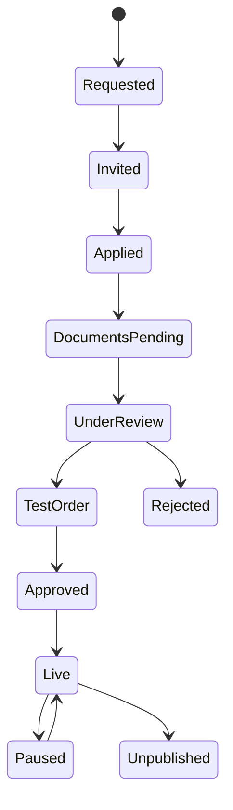
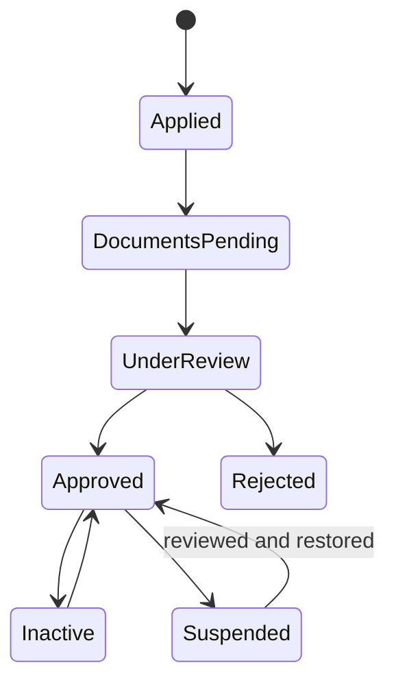
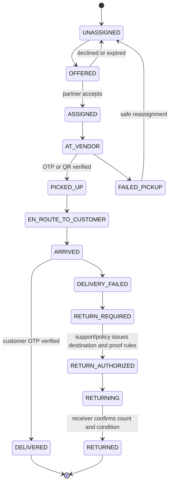
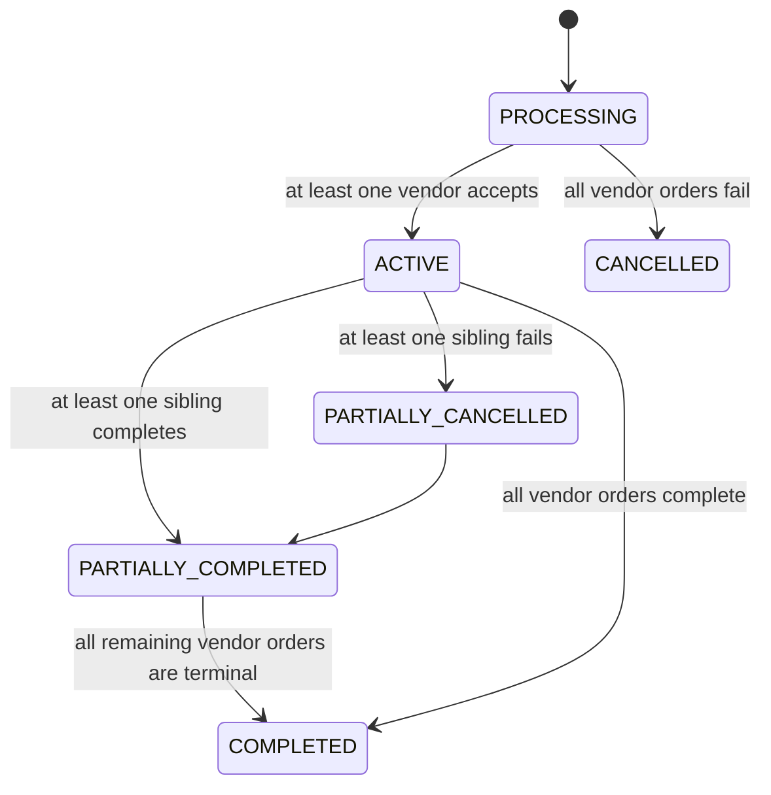
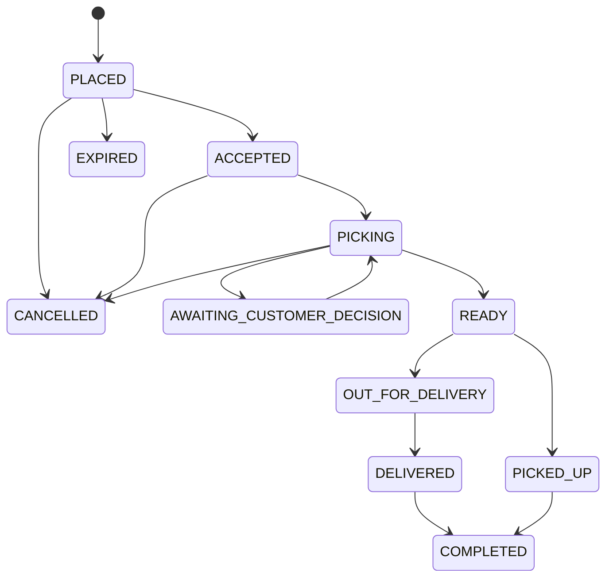
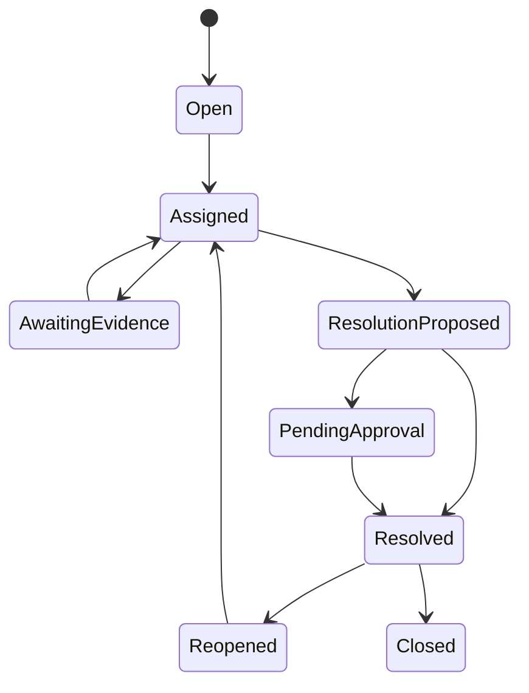
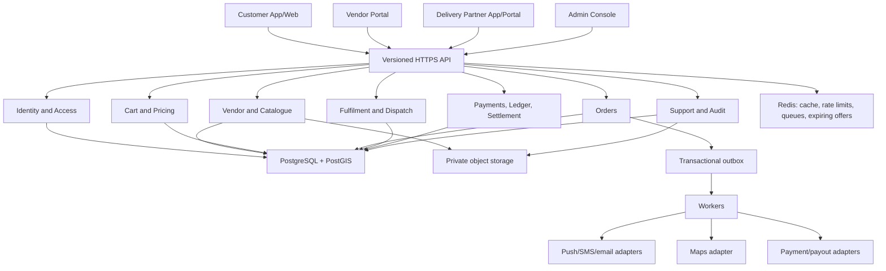

# End-to-End Workflow Architecture — Neighbourhood Store Marketplace

**Document status:** Product and implementation workflow reference
**Version:** v0.3 · synchronized 6 September 2026
**Surfaces:** Customer App/Web, Vendor Portal, Delivery Partner App/Portal, Admin Console
**Launch model:** One city, selected zones, multi-store checkout with vendor-scoped orders, prepaid payments, pickup/vendor delivery/platform delivery
**Languages:** English and Hindi for every core workflow
**Related documents:** [PRD](prd.md), [Design](design.md), [Architecture](architecture.md), [Implementation](implementation.md), [AI Rules](rules.md)

## 1. Purpose

This document joins all four product surfaces into one end-to-end operating workflow. It starts when a customer, vendor, delivery partner, or admin enters the platform and ends when the order, payment, settlement, payout, support, review, and audit workflows are complete.

It covers the common marketplace flow plus category-specific handling for:

- Fruits and vegetables
- Kirana and grocery
- Bakery
- Dairy
- Meat and seafood
- Specialty stores
- Pharmacy and medical shops as a disabled, regulated future workflow

This document owns business chronology. Exact default timers, identifiers, endpoint commands, worker retries, persistence constraints, and test gates live in `implementation.md`; workflow steps reference those contracts rather than creating alternate values.

The product remains vendor-first. Customers choose one or more named local stores; the platform does not own inventory or operate dark stores. A cart groups products by vendor location, and checkout creates one independent order per vendor. The platform charges vendors per successfully completed vendor order, not by monthly subscription.

## 2. Actors and responsibilities

| Actor | Enters through | Main responsibilities | Workflow ends when |
|---|---|---|---|
| Customer | Customer App/Web | Select location and stores, build grouped cart, approve changes, pay once, receive or collect each vendor order, report issues | Every vendor order is terminal and any review/support case is resolved |
| Vendor owner/staff | Vendor Portal | Maintain store/catalogue, accept order, pick, request changes, pack, hand off, review settlement | Vendor payout is reconciled and exceptions are closed |
| Delivery partner | Partner App/Portal | Become eligible, go online, accept suitable jobs, verify pickup/delivery, report exceptions | Trip earnings are posted and payout is reconciled |
| Admin/operations | Admin Console | Verify participants, configure zones/fees, monitor risk, intervene, refund, reconcile, audit | Order and financial records are consistent and all cases are closed |
| Platform services | Backend modules and workers | Identity, catalogue, pricing, order, fulfilment, dispatch, payment, notification, ledger, support, audit | Durable state and dependent events are processed idempotently |

## 3. Marketplace-wide workflow

```mermaid
flowchart LR
    A["Admin configures zone, fees, policies"] --> B["Admin verifies and publishes vendor"]
    A --> C["Admin verifies delivery partner"]
    B --> D["Customer selects address and named vendors"]
    D --> E["Customer builds cart grouped by vendor"]
    E --> F["Platform validates each group and creates grouped quote"]
    F --> G["Customer pays once; platform creates vendor orders"]
    G --> H["Each vendor independently accepts and prepares"]
    H --> I{"Customer decision needed?"}
    I -- Yes --> J["Customer approves or rejects change"]
    J --> H
    I -- No --> K["Order ready"]
    K --> L{"Fulfilment method"}
    L -- Customer pickup --> M["Pickup verified by OTP/order ID"]
    L -- Vendor delivery --> N["Vendor performs delivery"]
    L -- Platform delivery --> O["Partner accepts, picks up, delivers"]
    M --> P["Order completed"]
    N --> P
    O --> P
    P --> Q["Reconcile capture/refunds, ledger, vendor fee, earnings"]
    Q --> R["Vendor and partner payouts"]
    R --> S["Reconciliation, rating, support closure, audit"]
```

## 4. Shared entry, identity, language, and access workflow

### 4.1 First entry

1. The app opens in a white/light theme and offers **English / हिंदी**.
2. The user opens the separate Customer, Vendor, Delivery Partner, or Admin PWA/Android app. Selecting a role never grants membership or permissions.
3. The platform loads only the navigation and actions allowed for that role.
4. Phone OTP is used for customers, vendors, and delivery partners. Admins use the approved staff authentication flow with role-based access.
5. OTP requests are rate-limited. OTP values, tokens, full addresses, bank details, and prescriptions are never logged.
6. The chosen language applies to navigation, status labels, actions, alerts, error messages, help, and critical transaction information. Store and product names may remain in their original language, with optional translated aliases.

### 4.2 Session and authorization rules

- Browsing and cart building may occur before customer sign-in; checkout requires phone verification.
- Vendor users may access only their assigned store locations and permitted staff actions.
- Delivery partners see exact customer information only for an accepted active assignment and only when required for delivery.
- Admin users receive least-privilege access by function. High-risk actions require a reason and may require a second approver.
- The backend validates role, ownership, current state, and requested transition. Hiding a button in the UI is not authorization.

## 5. Admin setup and marketplace launch workflow

The admin flow starts before any customer can place an order.

### 5.1 Configure operating area

1. Admin creates the launch city, zones, pin-code clusters, and service polygons.
2. Admin configures the distance source, route calculation, quote expiry, rounding, and delivery formula.
3. Pilot example: ₹15 base including the first 2 route km, then ₹8 per route km, with a 40 route-km outer cap.
4. The 40 km value is only an outer limit. A vendor's zone, category, route serviceability, operating hours, and available delivery capacity may produce a smaller eligible range.
5. Admin configures the vendor fee charged per successfully completed order, cancellation/refund treatment, taxes, partner pay formula, payout windows, and approval thresholds.
6. Every published configuration has a version and effective date. Historical orders retain the version used when quoted.
7. Configuration follows draft → validate → pending approval → scheduled → active → superseded/rolled back. The proposer cannot approve the same material change, and rollback publishes a new version rather than mutating history.
8. Admin prepares scoped incident controls for checkout, dispatch, providers, payouts, and risky features. Each control has an owner, reason, impact preview, expiry/review time, recovery checklist, and audit reference.

### 5.2 Vendor onboarding and publication

1. A customer requests a shop, an admin creates a lead, or the vendor applies directly.
2. Admin records the legal/business identity, owner, address, map pin, contact, payout details, category, and operating model.
3. Vendor uploads required documents. Private files go to protected object storage and are reviewed through short-lived access.
4. Admin verifies category-specific documents and expiry dates.
5. Admin and vendor configure store name, photos, description, hours, holidays, preparation time, minimum order, fulfilment methods, service zone, and policies.
6. Vendor creates the catalogue manually or by CSV. Admin reviews taxonomy, prohibited items, image quality, units, prices, and restricted flags.
7. Admin configures the per-completed-order vendor fee and shows its impact before approval.
8. A test order verifies notifications, acceptance, picking, substitution, packaging, fulfilment, payment, settlement, and support contacts.
9. Admin publishes the storefront. Publication, pause, and unpublish actions always record actor, time, reason, and before/after state.
10. Time-bound documents enter expiring-soon reminders and reverification. Expiry blocks only the capability defined by policy; the console gives clear treatment for accepted orders, payouts, appeals, and restoration.

### 5.3 Delivery-partner onboarding

1. Partner signs in by phone OTP and chooses English or Hindi.
2. Partner enters name, photo, emergency contact, preferred zones, vehicle type, and payout account.
3. Partner uploads required identity, driving, vehicle, insurance, and bank documents under the approved local operating policy.
4. Partner completes training for safe pickup, customer privacy, OTP handling, package care, emergencies, and support escalation.
5. Admin verifies documents, assigns eligible zones/vehicle classes, and approves or rejects with an actionable reason.
6. The partner may go online only while approved, active, and document-compliant.
7. Expiring documents trigger partner reminders and an admin review queue. Restriction or rejection records evidence, affected capabilities, reason, review/appeal path, and safe handling of any active assignment or package custody.

## 6. Customer workflow: entry to completed order

### 6.1 Enter, choose location, and discover stores

1. Customer opens the app, selects English or Hindi, and allows location or enters an address manually.
2. The platform geocodes the address and checks eligible vendor zones. Location permission is optional.
3. If no store serves the address, the customer sees a coverage explanation and can request a shop or category.
4. The home screen shows search, categories, buy-again items, preferred/recent stores, and nearby named stores.
5. Search accepts store, product, brand, category, common misspelling, Hindi/English synonym, and transliterated queries. It preserves recent searches and ranks eligible available results ahead of unavailable ones.
6. Each store result shows name, verification, category, distance, open/closed state, next window, minimum order, rating, fulfilment estimate, pickup/delivery availability, and fee estimate.
7. The customer may favourite a store or set one as preferred. Ranking may favour loyalty and relevance but must not hide the fulfilling vendor.

### 6.2 Select vendors and browse catalogues

1. Customer opens a storefront with the vendor's identity, photo, hours, policies, fulfilment options, catalogue, reviews, and service information.
2. Customer searches within the store or browses category/subcategory sections.
3. Product cards show image, product name, pack/unit, price, truthful discount/reference price, stock state, and variable-weight information.
4. The platform validates price, stock, vendor, and serviceability when the customer taps **Add**.
5. The cart creates one visibly named group per vendor location. Adding from another eligible vendor creates a new group without clearing or changing existing groups.
6. Every group keeps its own subtotal, minimum, stock state, substitutions, fulfilment choice, timing, delivery fee, notes, and promotions. A configurable validation limit defaults to three stores; reaching it explains the limit and offers removal of a chosen group.

### 6.3 Cart and preferences

1. Customer reviews item quantity, unit, price, estimated total, and vendor name within each group.
2. For each eligible item or vendor group, the customer selects:
   - No substitution
   - Best match
   - Contact me
   - Vendor-selected substitute within an approved price limit
3. Variable-weight items show requested weight, permitted variance, price basis, and possible final amount range.
4. Customer chooses delivery or pickup per vendor group, adds group-specific notes, and sees whether each minimum order is met.
5. The cart persists across sign-in, OTP expiry, navigation, and temporary network loss.

### 6.4 Checkout and quote

1. Customer signs in or verifies phone if not already authenticated.
2. Customer selects a shared delivery address and an available fulfilment method/window for every vendor group; pickup groups use their own pickup point.
3. The server revalidates vendor status, hours, catalogue, stock confidence, address, zone, slot, minimum, and fulfilment method independently for every group.
4. For each delivery group, the platform calculates route distance and blocks routes beyond actual serviceability or the 40 route-km outer cap.
5. Pricing creates signed, expiring vendor quotes containing item totals, taxes, discounts, tip allocation, route distance, delivery formula/version, fee, and authorization buffer, plus one combined checkout-group quote.
6. Customer sees every vendor total, delivery/pickup fee, fulfilment window, and the combined authorization amount before commitment. The UI explains that vendors confirm independently and orders may arrive separately.
7. The MVP offers prepaid UPI, cards, and supported wallets. COD remains hidden until a separate reconciliation and risk policy is approved.
8. Customer taps **Place orders** once. An idempotency key prevents duplicate checkout groups, vendor orders, or payment authorizations from repeated taps.

### 6.5 Order placement and vendor response

1. The platform atomically locks the cart version and creates holds, checkout group, child-order drafts, allocation snapshots, payment attempt, ledger intents and outbox before gateway calls.
2. Provider order creation occurs outside that transaction. Hosted checkout, signature verification, durable webhooks and reconciliation confirm capture before vendor release. Unknown payment remains pending; late payment cannot resurrect expired holds. See D-15.
3. Customer sees the grouped checkout as `Processing`; each vendor sees only its own `Placed` order and receives a high-priority notification with its requested items, quantities, units, notes, substitution preferences, fulfilment method, and required response time.
4. Each vendor independently accepts with a preparation estimate or declines with a reason.
5. The initial response target is five minutes unless configured otherwise.
6. If one vendor does not respond, only that vendor order expires or auto-cancels. Accepted sibling orders continue, the failed allocation is voided or refunded, the customer sees the partial outcome, and the event affects that vendor's health reporting. No lines move to another vendor automatically.

### 6.6 Picking, substitutions, and price changes

1. Vendor picks each line and records picked quantity.
2. For an unavailable item, the vendor marks unavailable or proposes an allowed substitute.
3. For loose goods, the vendor records final measured weight and resulting price.
4. If the customer's saved rule already permits the change within its limit, the platform applies it and notifies the customer.
5. Otherwise, the order moves to `Awaiting customer decision`. The customer receives the original item, proposed item/weight, price difference, and decision deadline.
6. Customer approves or rejects. No response follows the customer's preselected fallback; if none exists, the item is removed or the order is escalated according to published policy.
7. The payment module refunds reductions or requests an explicitly approved top-up within the newly approved cap. Refusal follows the published remove-line/cancellation policy. Material changes are never hidden.
8. Vendor completes picking, seals/packages the order, records package count and handling notes, and marks it ready.

### 6.7 Fulfilment branch

#### Customer pickup

1. Customer receives `Ready for pickup`, store directions, hours, and pickup instructions.
2. Customer or approved collector identifies the order and presents its valid pickup OTP. An order ID alone never authorizes handover.
3. Vendor verifies the code, hands over the correct package count, and marks `Picked up`.
4. Platform moves the order to `Completed` after payment and integrity checks.

#### Vendor self-delivery

1. Vendor assigns an authorized staff member under the vendor's workflow.
2. Customer sees an honest delivery window and protected contact option.
3. Vendor confirms dispatch and delivery using the approved proof.
4. Platform records the fulfilment actor and completes the order after validation.

#### Platform delivery partner

1. When the order is accepted or near ready, dispatch finds eligible online partners by zone, vehicle, capacity, safety rules, and approximate route.
2. The offer shows vendor, approximate pickup/drop areas, total distance/effort, pickup deadline, expected pay, tip, package count, and handling needs.
3. Declined or expired offers return to the assignment pool without unsafe-pressure penalties.
4. On acceptance, the partner receives the exact pickup location. Customer details remain minimized until required.
5. Partner navigates to the vendor, marks arrival, and waits for handoff.
6. Vendor and partner confirm package count and pickup using QR/OTP. The order becomes `Out for delivery`.
7. The partner then receives the necessary customer address and instructions, navigates, and marks arrival.
8. Customer provides delivery OTP. The partner submits it; the server validates that the proof belongs to the active assignment.
9. On success the order becomes `Delivered`. Invalid/expired proof stays unresolved and offers retry or support.

### 6.8 Customer completion

1. Customer receives a checkout summary plus a final receipt for each vendor order, including item adjustments, allocated delivery fee, tip, refund information, and support window.
2. Customer may rate each vendor, its items, and each delivery experience separately.
3. Customer can favourite or prefer stores, reorder one vendor basket or selected lines, or open a support case against the relevant order.
4. Completed vendor orders feed buy-again and repeat-customer features without exposing vendor-private or partner-private data.

## 7. Vendor workflow: daily operations

### 7.1 Start of day

1. Owner/manager signs in, selects language, and sees store status, hours, document warnings, pending settlements, and action-required orders.
2. Authorized staff sets the store online/offline, temporary closure, current preparation time, and product availability.
3. Catalogue changes are stored with actor and time. Price changes affect new quotes only.
4. Vendor cannot override platform delivery pricing silently.
5. Stock displays last-confirmed time and confidence/source. Cart quantities do not create a reservation; checkout may create `SOFT_HELD`, placement creates `PROVISIONAL`, vendor acceptance creates `COMMITTED`, and rejection/cancellation/timeout creates `RELEASED` or `EXPIRED`. `VENDOR_CONFIRMS` records require human confirmation rather than pretending an exact count. Concurrent checkout decisions are atomic so the same counted stock cannot be committed twice.

### 7.2 New-order handling

1. Alert shows order number, countdown, customer request summary, fulfilment type, amount, exact item list, quantities/weights, notes, and substitution rules.
2. Before decline or cancellation, the portal previews affected items, customer/refund result, rider/return consequence, vendor-fee/settlement impact, and sibling isolation. Vendor accepts with realistic preparation time or declines with a standardized reason such as closed, stock mismatch, workload, serviceability, pricing error, prohibited/safety concern, or technical issue.
3. Accepted orders enter a prioritized pick queue. Urgent customer decisions, ageing orders, and rider arrivals appear above routine work.
4. Staff picks, substitutes, weighs, packs, and marks readiness through valid state transitions only.
5. Customer messages use in-app templates or masked contact and remain visible to support.
6. Vendor records package count, fragile/cold handling, and handoff notes.
7. The response alert escalates server-side: push/audible alert, reminder, SMS/provider fallback, then auto-cancel at the displayed deadline. Owners manage permitted devices, staff escalation order, test alerts, and delivery-failure history.
8. Vendor support uses structured reasons. Submission returns a case reference, responsible team, response target, current instruction, and resulting order state; the instruction stays on the order until resolution.

### 7.3 End of order and end of day

1. Vendor confirms pickup or rider handoff with OTP/QR.
2. Dashboard updates orders, gross sales, acceptance, cancellations, preparation time, ratings, and repeat customers.
3. Settlement ledger shows item revenue, tax, discounts, refunds, payment fee, vendor per-completed-order fee, adjustments, net amount, and payout status.
4. Vendor can download reports and dispute a line through support. The vendor cannot edit ledger history.

## 8. Delivery-partner workflow: online to payout

### 8.1 Go online and receive offer

1. Approved partner signs in, checks document status, chooses zone, grants required location consent, and switches online.
2. App displays battery/data guidance and does not assign a new job while an unresolved active proof exists.
3. Offer card displays expected earnings before acceptance. Exact customer address is not shown at the offer stage.
4. Partner accepts, declines, or lets the offer expire.

### 8.2 Complete active job

1. Partner follows one full-screen action at a time: receive/accept offer, navigate, arrive, verify pickup, navigate, arrive, verify delivery.
2. At pickup, partner checks vendor identity, order number, package count, damage, and handling notes before confirmation.
3. At delivery, partner follows address notes and uses masked contact only when needed.
4. Delivery OTP is the default proof. Photo/signature is allowed only under an approved consent and privacy policy.
5. After server confirmation, earnings show base, distance/time, waiting, return, incentives, tip, adjustments, and net payout.

### 8.2.1 Reassignment, waiting, and custody

1. An offer expiry, inability to proceed, vehicle failure, vendor delay, loss of movement/connectivity, customer cancellation, or admin action may create a new assignment attempt. Prior attempts remain immutable with partner, reason, actor, timestamps, ETA effect, compensation, and custody state; one vendor order has only one active assignment by default.
2. Trusted arrival starts a server wait timer. At configured thresholds the partner sees accrued waiting pay and can keep waiting, request reassignment, or contact support under the published policy.
3. Server-verified pickup records package count/condition and begins custody. Vendor edits are locked except through an auditable exception, and the partner cannot abandon or transfer the package without server authorization and a recorded handoff.

### 8.2.2 Return to origin

1. A cancellation or failed delivery after pickup becomes `ReturnRequired`, never ordinary cancellation.
2. Support or policy authorizes destination, handling, proof, and expected return earning. The partner sees vendor closed/refusal, alternate safe return point, perishables, damage, wrong/unsafe address, and customer-unreachable branches.
3. Partner returns the package; the receiving party records count and condition. Server confirmation ends custody and posts the return earning or opens a dispute.
4. Customer refund, vendor liability, partner compensation, and support resolution proceed as separately attributable records.

### 8.2.3 Safety, location, navigation, and earnings disputes

1. Emergency actions distinguish unsafe pickup/drop, harassment or threat, accident, medical emergency, vehicle breakdown, and prohibited-goods concern and route to the appropriate emergency or specialist queue.
2. Location collection starts only for an eligible online/active assignment under approved consent and frequency rules, buffers minimally offline, and stops when the assignment/approved operational need ends. Permission withdrawal produces a truthful safe-continue or stop path.
3. Navigation always offers preferred external map, text address, landmark/instructions, retry, incorrect-pin report, and support.
4. A partner may dispute any base, distance/time, waiting, return, incentive, tip, cash, adjustment, or payout line. The case shows original and proposed amount, evidence, owner, deadline, status, and final attributable decision.

### 8.3 Offline proof recovery

1. If connectivity fails after handoff, encrypted proof is saved locally against the active assignment.
2. The app says **Proof saved, waiting to sync** and never claims delivery is server-confirmed.
3. Retry uses the same idempotency key and cannot create duplicate transitions.
4. The partner follows the offline checklist and may leave only under the approved policy.
5. The partner cannot accept another job until synchronization succeeds or support resolves the assignment.

## 9. Category-specific workflows

All categories use the common order workflow. The following branches add controls without creating separate order systems.

| Category | Catalogue and cart | Vendor preparation | Delivery/handoff | Customer decision |
|---|---|---|---|---|
| Fruits and vegetables | ₹/kg, piece, bunch, grade, ripeness; estimated price range | Enter final weight; select quality; propose only permitted substitutes | Ventilated/crush-safe packaging | Approve weight variance or substitute when outside saved rule |
| Kirana/grocery | Pack size, brand, variant, MRP, selling price | Scan/check exact pack and expiry where relevant | Normal/fragile package count | Approve brand/size substitute and price difference |
| Bakery | Freshness date, size, flavour, egg/eggless, lead time | Confirm customization and ready time; mark fragile | Keep upright; protect decoration | Approve customization change or revised preparation time |
| Dairy | Pack size, temperature need, expiry, return policy | Check seal and expiry; keep chilled | Cold-handling note and fast handoff | Usually no substitute unless explicitly allowed |
| Meat/seafood | Type, cut, cleaned/uncleaned weight, preparation option | Record final prepared weight and hygiene completion | Leak-proof, temperature-safe packaging | Approve weight variance or cut/preparation change |
| Specialty store | Store-defined attributes, unit, preorder/lead time | Follow published product-specific checklist | Handling instructions travel with package | Approve material item, price, or timing change |
| Pharmacy/medical | Hidden in MVP; future flow requires licence, restricted flags, prescription rules | Human/pharmacist review; no automatic prescription substitution | Partner sees package handling only, never prescription contents | Required regulated confirmation under approved legal policy |

### 9.1 Pharmacy future-state gate

Pharmacy ordering is documented for architecture planning but remains disabled. No pharmacy tile, prescription upload, regulated product listing, or checkout path may appear until the owner explicitly approves legal, licensing, privacy, retention, pharmacist-review, substitution, restricted-product, delivery, and support policies.

When enabled in a future reviewed release, the flow is:

1. Admin verifies pharmacy licence, responsible pharmacist, service area, permitted catalogue, and expiry alerts.
2. Customer selects an eligible pharmacy and non-regulated items use the common flow.
3. A prescription-required item triggers a private prescription upload and consent notice.
4. Malware/file validation occurs; minimum required data is stored under stronger access and retention controls.
5. Authorized pharmacy staff reviews the prescription and records approved/rejected/clarification-required without exposing health information to delivery partners.
6. Prescription medicines cannot be automatically substituted.
7. Only after approval does the order proceed to payment completion and fulfilment.
8. Delivery package reveals no prescription contents or medical history.

## 10. Order, fulfilment, and financial states

### 10.1 Checkout-group summary state

The checkout-group state is a customer-facing projection. It never changes a child order directly. Every vendor order remains authoritative for its own acceptance, fulfilment, cancellation, refund, and settlement.

### 10.2 Customer-visible vendor-order state

Every transition records previous state, next state, actor, role, timestamp, reason/evidence, correlation ID, and idempotency key. Refund state may progress separately from the order state so the UI can truthfully show `Cancelled · Refund processing`.

### 10.3 Payment and ledger workflow

1. Every vendor quote reserves its fee formula/version and intended amount; the checkout-group quote records the combined authorization amount.
2. Checkout persists its attempt before provider calls and confirms capture before vendor release. Duplicate requests reuse the attempt/result; unknown outcomes reconcile before retrying money movement.
3. Immutable allocation records map items, taxes, fees, discounts, tips, authorization buffer, refunds, and final capture amounts to vendor orders.
4. Approved substitutions/weights determine each vendor order's final capturable allocation.
5. Delivery/pickup proof triggers that vendor order's completion but does not hide an unresolved checkout-level payment mismatch.
6. Fulfilment determines settlement eligibility, not delayed initial capture. Reduced totals refund child allocations; higher totals require approved and confirmed top-up under D-15. Repeated partial captures are not assumed.
7. Append-only ledger entries reconcile checkout-level customer payment with per-order vendor receivable, partner earning, platform/vendor fee, delivery revenue, tax, discount, tip, refund, and adjustment.
8. Normal vendor fee is posted only for an eligible successfully completed vendor order. A sibling order's failure does not change that result.
9. Vendor and partner amounts become payout-eligible after the configured dispute/completion window.
10. Payout worker submits idempotent requests. Reconciliation compares internal allocations with gateway/provider statements.
11. A mismatch enters manual review; staff never edit history to force a balance.

## 11. Exception, cancellation, refund, and support workflows

| Trigger | Immediate workflow | Financial treatment | Admin/support role |
|---|---|---|---|
| One vendor does not respond | Expire/auto-cancel that child order; continue accepted siblings; notify customer | Void/refund that allocation; no normal fee for failed vendor | Monitor repeat SLA failures and vendor health |
| One vendor declines | Cancel that child order with reason; continue siblings; suggest alternatives without changing vendor automatically | Void/refund only that allocation | Review abnormal decline patterns |
| Item unavailable | Follow saved substitution rule or ask customer | Capture adjusted amount or refund difference | Intervene only if decision/order is stuck |
| Customer decision times out | Apply explicit saved fallback; otherwise remove item/escalate under policy | Recalculate transparently | Resolve ambiguous or high-value cases |
| Vendor delay | Update ETA; partner may wait, unassign, or escalate | Waiting pay follows published policy | Reassign/cancel with recorded impact |
| No partner accepts | Retry eligible pool, offer pickup/vendor delivery if available, or cancel | Customer not charged for unprovided delivery; partner has no earning | Manual dispatch or service recovery |
| Failed pickup/missing package | Do not mark picked up; vendor corrects or case escalates | No delivery completion; treatment follows fault policy | Decide reassign/cancel/refund with evidence |
| Damaged package before pickup | Partner rejects handoff and records safe evidence | Vendor/order adjustment under policy | Review evidence and next fulfilment action |
| Customer unreachable | Masked contact attempts, wait timer, support, then return/cancel path | Partner waiting/return pay follows policy | Authorize return or alternative handoff |
| Wrong/unsafe address | Stop delivery and use safety flow | No improvised extra charge | Support changes plan or starts return |
| Invalid delivery OTP | Retry or approved alternative-proof support | No completion until valid proof | Verify identity/evidence without exposing OTP |
| Payment succeeds but order creation is uncertain | Show processing, reconcile idempotency key/payment reference | Never charge twice | Payment mismatch queue and safe recovery |
| Refund requested | Open support case with reason/evidence | Full/partial refund via idempotent transaction | Permissioned decision; dual approval over threshold |
| Quality/wrong/missing item | Customer uploads optional evidence and selects affected lines | Partial/full refund or credit per approved policy | Resolve dispute and record attributable outcome |
| Payout failure | Keep payable balance and retry safely | Never create duplicate payout | Reconcile provider response and bank status |
| Assignment must change before pickup | Close the current attempt and create a new attempt; preserve history and one active assignment | Post only policy-eligible wait/attempt compensation | Review reason, repeated failures, ETA, and customer communication |
| Cancellation/failure after pickup | Preserve custody and enter authorized return workflow | Post waiting/return earnings and customer/vendor adjustments separately | Own return instructions until custody is closed |
| Safety emergency | Stop normal progression; present emergency/specialist path and minimize exposure | No automatic penalty or improvised deduction | Protect the person first, preserve safe evidence, review later |
| Suspicious activity signal | Open trust review; apply only policy-based temporary protection if necessary | Freeze only scoped money movement where authorized | Review evidence, linked activity, impact, expiry, and appeal before durable restriction |

### 11.1 Cancellation principles

- Availability of customer/vendor cancellation depends on current order state and published policy.
- The customer may cancel one eligible vendor order or select several eligible orders from the checkout group. Cancelling one never silently cancels siblings.
- The UI displays likely refund and stakeholder impact before confirmation.
- Cancellation never skips payment release/refund, dispatch cancellation, notification, ledger, and audit work.
- If a partner already picked up the order, cancellation becomes a controlled return/support flow rather than a simple status change.

### 11.2 Support-case lifecycle

Cases contain category, order/assignment references, messages, safe evidence, owner, decisions, financial actions, and audit events. Access follows role and case ownership.

The case attaches to the smallest affected child order, assignment, payout, or ledger line. Resolution always returns a case reference, owner/team, service target, current instruction, operational result, and financial result. A sibling vendor order is changed only by its own separately authorized action.

## 12. Admin live-operations workflow

1. Admin signs in under a scoped role: support, vendor operations, delivery operations, trust and safety, finance operations/approval, configuration management/approval, auditor, or exceptional super-admin. The backend enforces permissions and separation of duties.
2. Dashboard ranks safety/security incidents first, then payment/ledger mismatches, ageing live-order exceptions, compliance blockers, and routine work using severity, age, financial exposure, custody, and affected-user count.
3. Live order monitor filters by checkout group, vendor order, vendor, zone, category, state, time in state, assignment/custody, and exception.
4. Admin opens the checkout group and selects a vendor-scoped child timeline with its own fulfilment, settlement, support cases, and payment/refund allocations. Siblings remain visible for context but isolated from the action.
5. Available actions depend on permission and valid state: contact, re-notify, reassign, authorize return, cancel, refund, partial refund, credit, pause storefront, restrict capability, or escalate.
6. Before intervention, the console shows customer, vendor, partner, custody, sibling, and financial impact. Admin enters a reason; high-risk/value actions create a pending approval that the proposer cannot approve.
7. The platform executes the approved command idempotently, writes the audit event, and exposes the reference. Admin verifies notification, refund, settlement, assignment/return, and support state before closure.
8. Finance works dedicated queues for authorized-not-ordered, captured-not-allocated, refund pending/failed, unbalanced ledger, settlement mismatch, payout failure/duplicate risk, and earning/settlement disputes. Corrections use reversal or adjustment records, never history edits.
9. Trust and safety reviews evidence, linked activity, impact, proposed restriction, expiry/review date, and appeal. A risk signal alone is not punishment; a durable restriction requires an attributable decision.
10. Configuration changes move through versioned draft, validation, approval, schedule, activation, and rollback. Incident controls are scoped, reversible, time-bound, and must preserve existing custody and financial history.

## 13. System architecture supporting the workflow

The MVP is a modular monolith. PostgreSQL is the durable source of truth, PostGIS handles geographic eligibility, Redis stores only short-lived/cache/queue state, and uploaded files live in private object storage with database ownership metadata. Cross-module side effects use a transactional outbox so saved business state cannot lose its notification or follow-up job.

## 14. Events and notifications

Event names in this section are the cross-role notification catalogue. The durable event envelope, versioning, privacy rule, consumer behavior, and worker ownership are defined in `implementation.md` §9.

Important durable events include:

- `checkout_group.placed`
- `checkout_group.partially_accepted`
- `checkout_group.partially_cancelled`
- `order.placed`
- `order.accepted`
- `order.vendor_response_expired`
- `order.customer_decision_required`
- `inventory.soft_hold_created`
- `inventory.reservation_committed`
- `inventory.reservation_released`
- `fulfilment.ready`
- `delivery.assignment_offered`
- `delivery.assignment_reassigned`
- `delivery.wait_threshold_reached`
- `delivery.custody_started`
- `delivery.picked_up`
- `delivery.return_authorized`
- `delivery.return_completed`
- `delivery.completed`
- `payment.captured`
- `refund.completed`
- `settlement.eligible`
- `vendor.document_expiring`
- `approval.requested`
- `incident_control.activated`
- `trust.review_opened`

Push/SMS notifications are helpful but not authoritative. Every app reloads current state from the server. Event consumers deduplicate by event ID. Payloads contain identifiers and minimum required facts, not full profiles, OTPs, prescriptions, or unnecessary addresses.

## 15. Data and privacy boundaries through the journey

| Stage | Customer data visible to vendor | Customer data visible to partner | Admin visibility |
|---|---|---|---|
| Browse/cart | None beyond aggregate analytics | None | Marketplace aggregates under role permission |
| Order placed | Order items, fulfilment needs, safe contact path; only necessary address details | None | Order monitor and risk metadata |
| Offer sent | Same as above | Approximate pickup/drop area, distance, package/handling summary | Offer/dispatch state |
| Assignment accepted | Same as above | Exact pickup; customer address only at approved delivery stage; masked contact | Active assignment and audit data |
| Order completed | Order record and support-visible communication | Own completed trip and earnings | Transaction, support, finance, and audit according to role |
| Pharmacy future flow | Authorized pharmacy staff only | No prescription contents or medical history | Restricted compliance/support roles only |

## 16. End-of-workflow completion criteria

An order is operationally finished only when all applicable checks pass:

- Final fulfilment proof is server-confirmed.
- Customer-visible order state is completed, cancelled, or otherwise terminal.
- Payment authorization/capture/refund is reconciled.
- Ledger entries balance and are append-only.
- Vendor fee eligibility is correct under the completed-order policy.
- Vendor settlement and partner earning are posted.
- Eligible payouts are completed or visibly pending/failed with recovery state.
- Notifications have been attempted and in-app state is current.
- Any support or dispute case has an owner and final resolution.
- Sensitive temporary proof has synchronized or expired under policy.
- Required audit events exist for manual or high-risk actions.
- Metrics update for conversion, acceptance, preparation, completion, delivery, refund, repeat use, earnings, and contribution.

## 17. Operational metrics by actor and category

| Area | Core metrics |
|---|---|
| Customer | Quote-to-paid conversion, fee-drop-off, multi-store checkout conversion, partial-acceptance rate, repeat orders, preferred-store orders, support rate |
| Vendor | Incremental orders, GMV, acceptance time/rate, preparation time, item-fill rate, substitutions, cancellations, rating, payout accuracy |
| Delivery partner | Offer acceptance, pickup delay, trip time, completion, earnings per active hour, failed/return trips, payout accuracy, safety incidents |
| Admin/marketplace | Active vendors/partners/customers, ageing orders, refund rate, vendor health, partner compliance, ledger mismatches, zone contribution |
| Category | Variable-weight variance, expiry/quality issues, cold/fragile handling failures, category conversion and repeat rate |

## 18. MVP boundaries and future expansion

The current workflow includes vegetables and kirana first, with bakery, dairy, meat, and specialty stores added only after operational validation. Multi-store checkout is supported through separate vendor orders and separate fulfilment promises. Automatic combined multi-pickup routing, pharmacy ordering, COD, automated route optimization, platform-owned stock, subscriptions, and a 10-minute promise remain outside the approved MVP.

Future features should extend these state machines and audit rules rather than bypass them. Any change to pricing, maximum distance, pharmacy, COD, payment, payout, cancellation, data access, or business model requires product-owner approval and synchronized updates to the PRD, design, architecture, rules, tests, and this document.

## Current staging contract and verification status

[D-15](docs/decisions/D-15.md) is the synchronized current-workstream decision for eight clients, staging providers, TLS/BFF boundaries, pre-payment durable checkout, weight caps/top-ups, role invitations, guest-cart merge, internal publication testing and privacy controls. Earlier conflicting local-only or deferred-provider wording is historical, not an active implementation restriction. Public production remains gated.

Scope labels are not completion claims. See the [phase conformance audit](docs/engineering/phase-conformance-audit.md) for reviewed steps, executable evidence and remaining gaps. Customer final prices and charge components remain visible; internal fee formulas/margins do not enter customer APIs. Moving maps, masked calling, POS sync, COD, pharmacy and consolidation remain deferred/gated.
